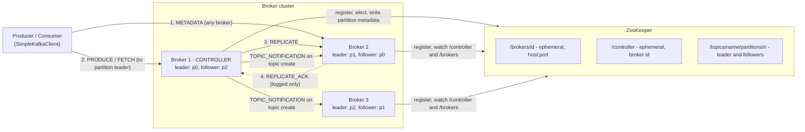
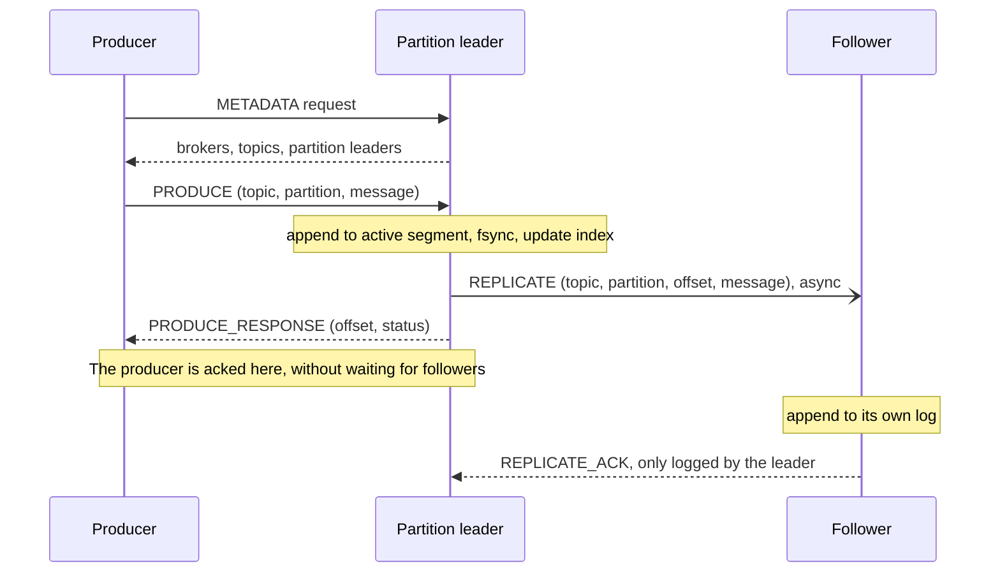

# SimpleKafka

[](https://github.com/kratikbhadoriya/SimpleKafka/actions/workflows/ci.yml)
[](LICENSE)

A from-scratch, educational Kafka-style distributed log in Java.

SimpleKafka re-implements the core ideas behind Apache Kafka in a small
codebase (about 2,500 lines of Java): a ZooKeeper-elected controller,
partitioned append-only logs, leader/follower replication and a custom binary
protocol over plain TCP, with a producer and consumer client.

**This is a learning project, not production Kafka.** It is not
wire-compatible with Apache Kafka, it has no tests yet, and it makes several
simplifications that would lose data in a real deployment. See
[Limitations](#limitations) before relying on it for anything.

New to the terms (controller, partition leader, follower, topic)? See the
[Glossary](GLOSSARY.md).

## Features

- **Controller election via ZooKeeper.** Each broker registers an ephemeral
  node under `/brokers`; the first to create the ephemeral `/controller` node
  becomes controller and the others watch it and re-elect when it disappears.
- **Topics and partitions.** A topic is split into N partitions. The
  controller assigns each partition a leader (round-robin over the registered
  brokers) and `replicationFactor - 1` followers, and stores the assignment in
  ZooKeeper under `/topics`.
- **Segmented, indexed, on-disk log.** Each partition is an append-only log
  split into 1 MiB segments named by their base offset, with a per-segment
  index of offset-to-file-position entries. Every append is forced to disk.
- **Leader/follower replication.** Producers write to the partition leader,
  which appends locally and then replicates to its followers.
- **Request forwarding.** A broker that receives a produce request for a
  partition it does not lead forwards it to the leader; a create-topic request
  sent to a non-controller is forwarded to the controller.
- **Leader reassignment.** When the controller sees that a partition's leader
  has left the cluster it assigns a new leader and followers from the
  remaining brokers.
- **Custom binary protocol.** Produce, fetch, metadata and create-topic
  requests plus internal replicate and topic-notification messages, all over
  plain TCP using Java NIO.
- **Clients.** A metadata-aware client (`SimpleKafkaClient`), a producer that
  can create the topic on demand, and a polling single-partition consumer.

## Architecture

### Components



- **Controller.** Exactly one broker holds the ephemeral `/controller` node.
  Only the controller creates topics (requests sent to other brokers are
  forwarded to it), writes partition assignments to ZooKeeper, tells the other
  brokers to load a new topic, and reassigns partitions whose leader has gone.
- **Partition leader.** Serves all produce and fetch traffic for its
  partition and owns the offset sequence.
- **Followers.** Hold a copy of the partition log, written only by the
  leader's `REPLICATE` messages. Clients always fetch from the leader.
- **Metadata.** Every broker answers `METADATA` with the brokers it knows
  about and, for each topic, each partition's leader and followers. The client
  uses it to find the leader to talk to.

### Produce, replicate and ack flow



The producer is acknowledged as soon as the leader has appended and synced the
message to its own disk. Replication to followers is submitted to a thread pool
and is not awaited, so the acknowledgement does not mean the message exists on
any follower. This is comparable to Kafka's `acks=1`, without any in-sync
replica tracking. If the producer sent the request to a broker that is not the
partition leader, that broker forwards it to the leader and relays the
response.

Consumers fetch from the leader of the partition by offset (`FETCH`); the
leader answers with the messages starting at that offset, up to `maxBytes`.

## Quick Start

### Prerequisites

- JDK 25 and Maven (needed for the plain `java -jar` path; Docker builds the jar itself)
- Docker with Compose (optional; only for the Docker Compose path)

### Option 1: Docker Compose (ZooKeeper + 3 brokers)

```bash
docker compose up --build
```

The first run builds the shaded jar inside Docker and pulls the ZooKeeper image.
Wait until the logs show `Elected controller is ...` and each broker prints
`SimpleKafka broker started`. The brokers start one after another (a few
seconds apart); that is intentional, because brokers started at the same instant
can end up with an incomplete view of the cluster.

Brokers 1, 2 and 3 listen on `localhost:9092`, `9093` and `9094`, but only
inside the cluster's network namespace; no ports are published to the host.
Run the clients inside a broker container (in a second terminal):

```bash
# Produce 10 messages to topic "demo" (the producer creates the topic
# with 3 partitions and replication factor 2 if it does not exist)
docker compose exec -T broker1 java -cp /app/simplekafka.jar \
  com.simplekafka.client.SimpleKafkaProducer localhost 9092 demo

# Consume partition 0 of "demo" (press Enter to stop; use partition 0, 1 or 2)
docker compose exec broker1 java -cp /app/simplekafka.jar \
  com.simplekafka.client.SimpleKafkaConsumer localhost 9092 demo 0
```

Messages are sent to a random partition, so consume partitions 0, 1 and 2 to
see all 10 messages. Expected consumer output:

```
Message received at offset 0: Message 1- 1791829988307
Message received at offset 1: Message 2- 1791829989569
...
```

Stop and clean up with `docker compose down -v`.

### Option 2: plain `java -jar`

The broker looks for ZooKeeper on `localhost`. Start one (any ZooKeeper 3.x
works; here via Docker, mapped to host port 2182 so it does not clash with a
ZooKeeper already running on 2181):

```bash
docker run -d --rm --name sk-zk -p 2182:2181 zookeeper:3.9
```

Build the jar:

```bash
mvn package -DskipTests
```

Start three brokers, each in its own terminal, a few seconds apart. Arguments
are `<brokerId> <brokerHost> <brokerPort> [zooKeeperPort]` (ZooKeeper port
defaults to 2181):

```bash
java -jar target/SimpleKafka-1.0-SNAPSHOT.jar 1 localhost 9092 2182
java -jar target/SimpleKafka-1.0-SNAPSHOT.jar 2 localhost 9093 2182
java -jar target/SimpleKafka-1.0-SNAPSHOT.jar 3 localhost 9094 2182
```

The first broker logs `Elected controller is 1`. Brokers write their logs under
`./data` in the directory they are started from.

Produce and consume (in two more terminals):

```bash
java -cp target/SimpleKafka-1.0-SNAPSHOT.jar \
  com.simplekafka.client.SimpleKafkaProducer localhost 9092 demo

java -cp target/SimpleKafka-1.0-SNAPSHOT.jar \
  com.simplekafka.client.SimpleKafkaConsumer localhost 9092 demo 0
```

Producer arguments: `<broker> <port> <topic>`. Consumer arguments:
`<broker> <port> <topic> <partition>`.

## Limitations

SimpleKafka is a teaching implementation. Known gaps, all checked against the
source:

**Durability and replication**

- **Producer acks do not wait for replication.** The leader responds after its
  own local append; replication is fire-and-forget and a failed replicate is
  only logged. There is no in-sync-replica set, high watermark or minimum
  replica setting, so an acknowledged message can be lost if the leader fails
  before replicating.
- **Followers never catch up.** A follower appends whatever the leader sends
  and does not check the offset (there is a `TODO: Repair the log` in
  `handleReplicationRequest`). A follower that was down misses those messages
  permanently.
- **Failover is simplistic.** When a leader disappears, the controller picks
  the first broker in its cluster view as the new leader, which is not
  necessarily a replica that holds the data. There are no leader epochs or log
  truncation, and the other brokers are not told about the reassignment, so
  their in-memory view of the leader can go stale.
- **No rebalancing on cluster growth.** Partitions are reassigned only when
  their leader has left; adding a broker does not move existing partitions.
- **Partition directories are inconsistent.** The controller creates a
  partition under `data/<topic>/<partition>`, but loading from ZooKeeper
  (which every broker does on restart) uses
  `data/<brokerId>/<topic>/<partition>`, so a restarted controller does not
  pick up the logs it created.
- **No retention or compaction.** Segments are never deleted.

**Deployment**

- **ZooKeeper address is hardcoded to `localhost`.** `SimpleKafkaBroker`
  accepts only a ZooKeeper port, so ZooKeeper must be reachable on the
  broker's own `localhost`.
- **`brokerHost` is used for both binding and advertising.** The same value is
  bound to and published in ZooKeeper; there is no separate advertised
  address. In Docker this is why the Compose file puts the brokers in
  ZooKeeper's network namespace and why clients must run inside the Compose
  network (see Quick Start).
- **Simultaneous broker startup can race.** Brokers that register at the same
  instant can end up with an incomplete view of the cluster (observed while
  verifying the Quick Start; the broker list is kept up to date by one-shot
  ZooKeeper watches that are re-armed in their callback). The Compose file
  staggers startup to avoid this.

**Protocol and clients**

- **No message framing.** The broker handles each request from a single
  1024-byte socket read and the client reads each response with a single
  4 KiB read, so large messages, fetches and metadata responses are not
  supported.
- **Producer.** Sends each message on a new connection to a random partition;
  there are no keys, batching, retries or configurable acks.
- **Consumer.** Reads a single partition, has no consumer groups or committed
  offsets, and starts from offset 0 unless seeked. The command-line consumer
  waits for Enter on stdin, so it exits immediately if stdin is closed.
- **No security.** No authentication, authorization or TLS.
- **No automated tests yet** (see Roadmap).

## Roadmap

- **Tests.** Unit and integration tests for the log, protocol and replication
  path: [#2](https://github.com/kratikbhadoriya/SimpleKafka/issues/2).
- Make the ZooKeeper address configurable and separate the bind address from
  the advertised address, so Docker no longer needs a shared network namespace.
- Make broker registration and controller election safe under simultaneous
  startup.
- Follower catch-up and truncation, an in-sync replica set and a high
  watermark so consumers only see replicated data.
- Notify all brokers of leader changes and pick new leaders from replicas.
- Fix the partition directory layout so a restarted controller recovers its
  logs.
- Length-prefixed framing for requests and responses.
- Consumer offsets and consumer groups, and a consumer that does not depend on
  stdin.

## License

Released under the [MIT License](LICENSE). Copyright (c) 2026 Kratik Bhadoriya.
