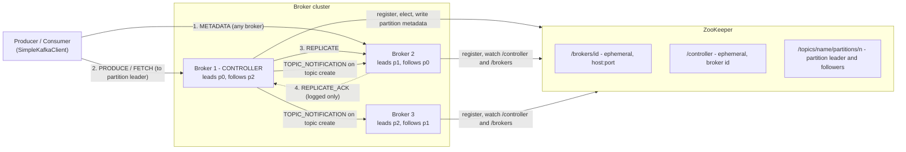
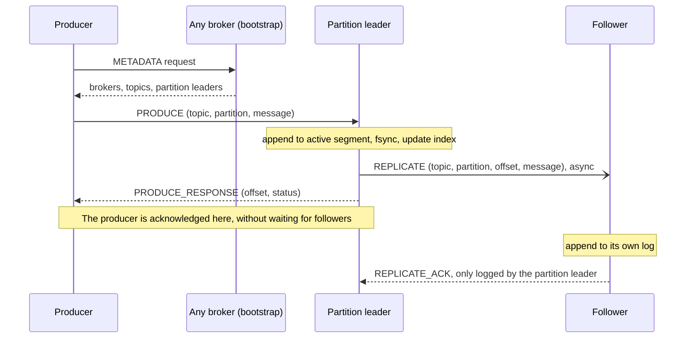

# SimpleKafka

[](https://github.com/kratikbhadoriya/SimpleKafka/actions/workflows/ci.yml)
[](LICENSE)

A from-scratch, educational Kafka-style distributed log in Java.

SimpleKafka re-implements the core ideas behind Apache Kafka in a small
codebase (about 2,500 lines of Java): a ZooKeeper-elected controller,
partitioned append-only logs, leader/follower replication and a custom binary
protocol over plain TCP, with a producer and consumer client.

**This is a learning project, not production Kafka.** It is not
wire-compatible with Apache Kafka, it has no tests yet, and it makes several
simplifications that would lose data in a real deployment. See
[Limitations](#limitations) before relying on it for anything.

New to the terms (controller, partition leader, follower, topic)? See the
[Glossary](GLOSSARY.md).

## Features

- **Controller election via ZooKeeper.** Each broker registers an ephemeral
  node under `/brokers`; the first to create the ephemeral `/controller` node
  becomes controller and the others watch it and re-elect when it disappears.
- **Topics and partitions.** A topic is split into N partitions. The
  controller assigns each partition a partition leader (round-robin over the
  registered brokers) and `replicationFactor - 1` followers, and stores the
  assignment in ZooKeeper under `/topics`.
- **Segmented, indexed, on-disk log.** Each partition is an append-only log
  split into 1 MiB segments named by their base offset, with a per-segment
  index of offset-to-file-position entries. Every append is forced to disk.
- **Leader/follower replication.** Producers write to the partition leader,
  which appends locally and then replicates to its followers.
- **Request forwarding.** A broker that receives a produce request for a
  partition it does not lead forwards it to the partition leader; a create-topic request
  sent to a non-controller is forwarded to the controller.
- **Partition leader reassignment.** When the controller sees that a
  partition's leader has left the cluster it assigns a new partition leader
  and followers from the remaining brokers.
- **Custom binary protocol.** Produce, fetch, metadata and create-topic
  requests plus internal replicate and topic-notification messages, all over
  plain TCP using Java NIO.
- **Clients.** A metadata-aware client (`SimpleKafkaClient`), a producer that
  can create the topic on demand, and a polling single-partition consumer.

## Architecture

### Components



- **Controller.** Exactly one broker holds the ephemeral `/controller` node.
  Only the controller creates topics (requests sent to other brokers are
  forwarded to it), writes partition assignments to ZooKeeper, tells the other
  brokers to load a new topic, and reassigns partitions whose partition leader
  has gone.
- **Partition leader.** Serves all produce and fetch traffic for its
  partition and owns the offset sequence.
- **Followers.** Hold a copy of the partition log, written only by the
  partition leader's `REPLICATE` messages. Clients always fetch from the
  partition leader.
- **Metadata.** Every broker answers `METADATA` with the brokers it knows
  about and, for each topic, each partition's partition leader and followers. The
  client uses it to find the partition leader to talk to.

### Produce, replicate and acknowledgement flow



The producer is acknowledged once the partition leader has appended and synced
the message to its own disk; replication is not awaited (details in
[Limitations](#limitations)). If the producer sent the request to a broker that
is not the partition leader, that broker forwards it to the partition leader
and relays the response.

Consumers fetch from the partition leader by offset (`FETCH`); the
partition leader answers with the messages starting at that offset, up to `maxBytes`.

## Quick Start

### Prerequisites

- JDK 25 and Maven (needed for the plain `java -jar` path; Docker builds the jar itself)
- Docker with Compose (optional; only for the Docker Compose path)

### Option 1: Docker Compose (ZooKeeper + 3 brokers)

```bash
docker compose up --build
```

The first run builds the shaded jar inside Docker and pulls the ZooKeeper image.
Wait until the logs show `Elected controller is ...` and each broker prints
`SimpleKafka broker started`. The brokers start one after another (a few
seconds apart) on purpose; see
[Simultaneous broker startup can race](#limitations).

Brokers 1, 2 and 3 listen on `localhost:9092`, `9093` and `9094`, but only
inside the cluster's network namespace; no ports are published to the host.
Run the clients inside a broker container (in a second terminal):

```bash
# Produce 10 messages to topic "demo" (the producer creates the topic
# with 3 partitions and replication factor 2 if it does not exist)
docker compose exec -T broker1 java -cp /app/simplekafka.jar \
  com.simplekafka.client.SimpleKafkaProducer localhost 9092 demo

# Consume partition 0 of "demo" (press Enter to stop; use partition 0, 1 or 2)
docker compose exec broker1 java -cp /app/simplekafka.jar \
  com.simplekafka.client.SimpleKafkaConsumer localhost 9092 demo 0
```

Messages are sent to a random partition, so consume partitions 0, 1 and 2 to
see all 10 messages. Expected consumer output:

```
Message received at offset 0: Message 1- 1791829988307
Message received at offset 1: Message 2- 1791829989569
...
```

Stop and clean up with `docker compose down -v`.

### Option 2: plain `java -jar`

The broker looks for ZooKeeper on `localhost`. Any ZooKeeper 3.x works; pick
one of the two ways to start it.

**Without Docker** (needs only a JDK): download any 3.x binary release from
<https://zookeeper.apache.org/releases.html> (the commands assume 3.9.3;
adjust the file name) and start it with the sample
configuration, which listens on port 2181:

```bash
tar xzf apache-zookeeper-3.9.3-bin.tar.gz
cd apache-zookeeper-3.9.3-bin
cp conf/zoo_sample.cfg conf/zoo.cfg
bin/zkServer.sh start
```

Stop it later with `bin/zkServer.sh stop`. If something else already uses port
2181 (or 8080, the ZooKeeper admin server), change `clientPort` and add
`admin.serverPort=<free port>` in `conf/zoo.cfg`, and pass that client port
as the last broker argument below.

**With Docker**, mapped to host port 2182 so it does not clash with a
ZooKeeper already running on 2181:

```bash
docker run -d --rm --name sk-zk -p 2182:2181 zookeeper:3.9
```

The broker commands below pass ZooKeeper port 2182 to match the Docker
command. With the Docker-free sample configuration, replace `2182` with
`2181` (or drop the last argument).

Build the jar:

```bash
mvn package -DskipTests
```

Start three brokers, each in its own terminal, a few seconds apart. Arguments
are `<brokerId> <brokerHost> <brokerPort> [zooKeeperPort]` (ZooKeeper port
defaults to 2181):

```bash
java -jar target/SimpleKafka-1.0-SNAPSHOT.jar 1 localhost 9092 2182
java -jar target/SimpleKafka-1.0-SNAPSHOT.jar 2 localhost 9093 2182
java -jar target/SimpleKafka-1.0-SNAPSHOT.jar 3 localhost 9094 2182
```

The first broker logs `Elected controller is 1`. Brokers write their logs under
`./data` in the directory they are started from.

Produce and consume (in two more terminals):

```bash
java -cp target/SimpleKafka-1.0-SNAPSHOT.jar \
  com.simplekafka.client.SimpleKafkaProducer localhost 9092 demo

java -cp target/SimpleKafka-1.0-SNAPSHOT.jar \
  com.simplekafka.client.SimpleKafkaConsumer localhost 9092 demo 0
```

Producer arguments: `<broker> <port> <topic>`. Consumer arguments:
`<broker> <port> <topic> <partition>`.

## Wire protocol reference

The protocol is defined in `com.simplekafka.broker.Protocol`. It is a custom
binary protocol over plain TCP, not compatible with Kafka's. Every message
starts with a one-byte type. All integers are big-endian (Java `ByteBuffer`
default). There is **no outer length prefix**: a message is whatever one
socket read returns (see [Limitations](#limitations)).

Field notation: `string` is a `short` length followed by that many bytes
(default charset; the length is written as `String.length()`, so only ASCII
topic names and hosts are safe). `bytes` is an `int` length followed by that
many bytes.

### Message types

| Hex  | Name                    | Direction                         |
|------|-------------------------|-----------------------------------|
| 0x01 | `PRODUCE`               | client to broker                  |
| 0x02 | `FETCH`                 | client to broker                  |
| 0x03 | `METADATA`              | client to broker                  |
| 0x04 | `CREATE_TOPIC`          | client to broker (or broker to controller) |
| 0x11 | `PRODUCE_RESPONSE`      | broker to client                  |
| 0x12 | `FETCH_RESPONSE`        | broker to client                  |
| 0x13 | `METADATA_RESPONSE`     | broker to client                  |
| 0x14 | `CREATE_TOPIC_RESPONSE` | broker to client (or controller to broker) |
| 0x15 | `ERROR_RESPONSE`        | broker to client                  |
| 0x21 | `REPLICATE`             | partition leader to follower      |
| 0x22 | `REPLICATE_ACK`         | follower to partition leader      |
| 0x23 | `TOPIC_NOTIFICATION`    | controller to broker              |

### Requests

| Type | Layout after the type byte | Notes |
|------|----------------------------|-------|
| `PRODUCE` | `string topic`, `int partition`, `bytes message` | A broker that is not the partition leader forwards it to the partition leader. |
| `FETCH` | `string topic`, `int partition`, `long offset`, `int maxBytes` | The broker does not check that it is the partition leader; the client sends it to the partition leader. |
| `METADATA` | (empty) | One-byte request. |
| `CREATE_TOPIC` | `string topic`, `int numPartitions`, `short replicationFactor` | A non-controller forwards it to the controller. |
| `REPLICATE` | `string topic`, `int partition`, `long offset`, `bytes message` | Partition leader to follower, internal. |
| `TOPIC_NOTIFICATION` | `string topic` | Controller to broker, internal. Tells the broker to load the topic from ZooKeeper. |

### Responses

| Type | Layout after the type byte | Notes |
|------|----------------------------|-------|
| `PRODUCE_RESPONSE` | `long offset`, `byte status` | Status 0 is success, 1 means the local append failed (offset is then -1). |
| `FETCH_RESPONSE` | `int count`, then `count` x (`long offset`, `bytes message`) | An empty fetch is `count = 0`. |
| `METADATA_RESPONSE` | `int numBrokers`, then per broker (`int id`, `string host`, `int port`); `int numTopics`, then per topic (`string topic`, `int numPartitions`, then per partition `int id`, `int leader`, `int numFollowers`, `int followerId` x numFollowers) | The list contains followers only; the partition leader is not repeated in it. |
| `CREATE_TOPIC_RESPONSE` | `byte status` | Always 0 on this path, even if the controller failed to create the topic internally (the failure is only logged). |
| `ERROR_RESPONSE` | `string message` | Used for unknown topic or partition, invalid topic configuration, unknown message type and forwarding failures. |
| `REPLICATE_ACK` | (none) | A single `0x22` byte on success. On unknown topic or partition the follower replies with a single `0x00` byte instead. |

`TOPIC_NOTIFICATION` is answered with a single status byte that is not a type
code: 0 if the topic was loaded, 1 if loading failed. The controller reads and
ignores it.

## Design decisions & trade-offs vs. real Kafka

Each subsection says what SimpleKafka does, what Apache Kafka does, and why
the simpler choice was made here. The known consequences are listed in
[Limitations](#limitations); this section is about the reasoning.

### Controller election

- **Here.** Every broker registers `/brokers/<id>` as an ephemeral node and
  tries to create the ephemeral `/controller` node; whoever creates it is
  controller, and everyone else sets a watch on it and re-runs the election
  when it changes. Brokers also watch `/brokers` to keep their cluster view
  and, on change, the controller reassigns partitions whose partition leader
  has gone. Connecting to ZooKeeper also creates a persistent, empty
  `/controller` placeholder; `electController` first deletes it if it has no
  data and then creates the ephemeral node. That check-then-delete is not
  atomic, so a broker can delete a controller node another broker has just
  created.
- **Kafka.** The same ZooKeeper-era mechanism (ephemeral `/controller` node),
  but with a monotonically increasing controller epoch that fences a stale
  controller, and the controller pushes leader and ISR changes to every
  affected broker. Newer Kafka replaces ZooKeeper with a KRaft quorum.
- **Trade-off.** An ephemeral node is the smallest correct-looking election
  primitive and is easy to follow, which is the point of the project. Without
  an epoch, a controller that is partitioned from ZooKeeper but still alive
  is not fenced, and because partition leader changes are written to ZooKeeper but not
  broadcast, other brokers learn of them only when they restart and reload topics.

### Replication and acknowledgement

- **Here.** The partition leader appends and fsyncs, submits one `REPLICATE`
  task per follower to a thread pool, and replies to the producer immediately.
  It pushes to followers, which append whatever arrives; the acknowledgement
  from the follower is only logged. Each `REPLICATE` is an independent task on
  its own connection, so followers may apply messages out of order (see
  [Limitations](#limitations)).
- **Kafka.** Followers pull from the leader with fetch requests, so they can
  resume from their own log end offset after a gap. The leader tracks an
  in-sync replica set and a high watermark, only exposes messages below the
  high watermark to consumers, and with `acks=all` acknowledges once every
  in-sync replica has the message (subject to `min.insync.replicas`). Leader
  epochs let a returning replica truncate divergent entries.
- **Trade-off.** Push-and-forget is the shortest path to a visible
  partition-leader-to-follower copy and keeps the produce latency to the
  local forced writes of the log and index (no network round trip).
  It is roughly Kafka's `acks=1` with no ISR bookkeeping, and gives none of
  the guarantees the pull-based design provides: no catch-up, no truncation
  and no way to say which follower is safe to promote.

### Storage

- **Here.** Each partition directory holds segments named by their 20-digit
  zero-padded base offset (`.log` plus `.index`). Each message is stored as a
  4-byte length followed by the message bytes; an index entry is 16 bytes (`long`
  offset, `long` file position) written for every message, so a lookup is a
  seek to `(offset - baseOffset) * 16`. A new segment starts once the active
  log is at least 1 MiB when an append arrives. Both files are forced to disk
  on every append. On restart the next offset is rebuilt by scanning the last
  segment's messages.
- **Kafka.** Messages are written in batches with a CRC, timestamps and
  headers; the offset index is sparse (one entry per few KiB) and searched
  with a binary search, and there is a separate time index. Segments default
  to 1 GiB, are subject to time and size retention or compaction, and are
  flushed by the OS page cache rather than per message, relying on
  replication for durability.
- **Trade-off.** A dense index makes lookup trivial to read and verify, and
  an fsync per message makes single-broker durability easy to reason about,
  at the cost of an index as large as the message count and very low
  throughput. There is no checksum, no batching and no retention.

### Consumer offsets

- **Here.** The consumer holds its next offset in memory
  (`SimpleKafkaConsumer.currentOffset`, advanced after each poll, settable
  with `seek`). The broker stores nothing about consumers, so a restarted
  consumer begins at offset 0 again and there is no group membership or
  partition assignment.
- **Kafka.** Offsets are committed to the internal `__consumer_offsets`
  topic, keyed by group, topic and partition. A group coordinator manages
  membership and rebalances partitions across the group, and
  `auto.offset.reset` decides where a consumer without a committed offset
  starts.
- **Trade-off.** Client-owned offsets keep the broker stateless with respect
  to consumers and leaves the protocol without any group or offset-commit
  request. It makes the consumer a "read one partition from offset N"
  primitive, and it is the first thing to replace if the project grows (see
  Roadmap).

## Limitations

SimpleKafka is a teaching implementation. Known gaps, all checked against the
source:

**Durability and replication**

- **Acknowledgements do not wait for replication.** The partition leader
  acknowledges the producer after its own local append and syncs it to disk;
  replication is fire-and-forget and a failed replicate is only logged. There
  is no in-sync set, high watermark or minimum-in-sync setting (comparable to
  Kafka's `acks=1`), so an acknowledged message can be lost if the
  partition leader fails before replicating.
- **Followers never catch up, and may apply messages out of order.** A
  follower appends whatever the partition leader sends and does not check the
  offset (there is a `TODO: Repair the log` in `handleReplicationRequest`). A
  follower that was down misses those messages permanently. Each `REPLICATE`
  is an independent task on its own connection, so nothing guarantees
  followers apply messages in the partition leader's order.
- **Followers are capped at two on reassignment.** Topic creation honours the
  requested replication factor (up to the cluster size), but when the
  controller reassigns a partition whose partition leader has left, it assigns
  at most `min(brokers, 3) - 1` followers, i.e. two, regardless of the
  topic's replication factor.
- **Failover is simplistic.** When a partition leader disappears, the
  controller picks the first broker in its cluster view as the new partition
  leader, which is not necessarily a follower that holds the data. There are
  no leader epochs or log truncation, and the other brokers are not told
  about the reassignment, so their in-memory view of the partition leader can go
  stale.
- **No rebalancing on cluster growth.** Partitions are reassigned only when
  their partition leader has left; adding a broker does not move existing partitions.
- **Partition directories are inconsistent.** The controller creates a
  partition under `data/<topic>/<partition>`, but loading from ZooKeeper
  (which every broker does on restart) uses
  `data/<brokerId>/<topic>/<partition>`, so a restarted controller does not
  pick up the logs it created.
- **No retention or compaction.** Segments are never deleted.
- **File descriptor leak.** `Partition.updateIndex` opens a
  `RandomAccessFile` for the index on every append and never closes it, and
  `readMessages` does not close its log file on the normal path, so a
  long-running broker accumulates open file descriptors.
- **A first message larger than `maxBytes` stalls the consumer.**
  `readMessages` stops before a message that does not fit in `maxBytes` and,
  when it is the first one, returns nothing. The consumer then asks for the
  same offset again forever.

**Deployment**

- **ZooKeeper address is hardcoded to `localhost`.** `SimpleKafkaBroker`
  accepts only a ZooKeeper port, so ZooKeeper must be reachable on the
  broker's own `localhost`.
- **`brokerHost` is used for both binding and advertising.** The same value is
  bound to and published in ZooKeeper; there is no separate advertised
  address. In Docker this is why the Compose file puts the brokers in
  ZooKeeper's network namespace and why clients must run inside the Compose
  network (see Quick Start).
- **Producing to a new topic can fail on the first run.** When the producer
  creates the topic on demand, topic creation is asynchronous and the
  producer's next metadata lookup can still miss it, so the first run may
  print `Topic doesn't exist: <topic>` even though the topic was created;
  run the producer again.
- **Simultaneous broker startup can race.** Brokers that register at the same
  instant can end up with an incomplete view of the cluster (observed while
  verifying the Quick Start, and visible as `NoNode for /controller` errors in
  the broker log when the `/controller` placeholder is deleted and re-created
  concurrently; the broker list is kept up to date by one-shot
  ZooKeeper watches that are re-armed in their callback). The Compose file
  and the plain `java -jar` instructions therefore stagger startup.

**Protocol and clients**

- **No message framing.** The broker handles each request from a single
  1024-byte socket read and the client reads each response with a single
  4 KiB read, so large messages, fetches and metadata responses are not
  supported.
- **Producer.** Sends each message on a new connection to a random partition;
  there are no keys, batching, retries or configurable acknowledgement levels.
- **Consumer.** Reads a single partition, has no consumer groups or committed
  offsets, and starts from offset 0 unless seeked. The command-line consumer
  waits for Enter on stdin, so it exits immediately if stdin is closed.
- **No security.** No authentication, authorization or TLS.
- **No automated tests yet** (see Roadmap).

## Roadmap

- **Tests.** Unit and integration tests for the log, protocol and replication
  path: [#2](https://github.com/kratikbhadoriya/SimpleKafka/issues/2).
- Make the ZooKeeper address configurable and separate the bind address from
  the advertised address, so Docker no longer needs a shared network namespace.
- Make broker registration and controller election safe under simultaneous
  startup.
- Follower catch-up and truncation, an in-sync set of followers and a high
  watermark so consumers only see replicated data; apply replicated messages
  in order.
- Notify all brokers of partition leader changes and pick new
  partition leaders from followers; do not cap followers on reassignment.
- Close the index and log files in `Partition`, and make `readMessages`
  return an oversized first message (or fail loudly) instead of nothing.
- Fix the partition directory layout so a restarted controller recovers its
  logs.
- Length-prefixed framing for requests and responses.
- Consumer offsets and consumer groups, and a consumer that does not depend on
  stdin.

## License

Released under the [MIT License](LICENSE). Copyright (c) 2026 Kratik Bhadoriya.
